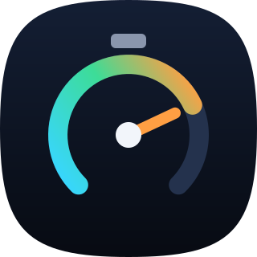
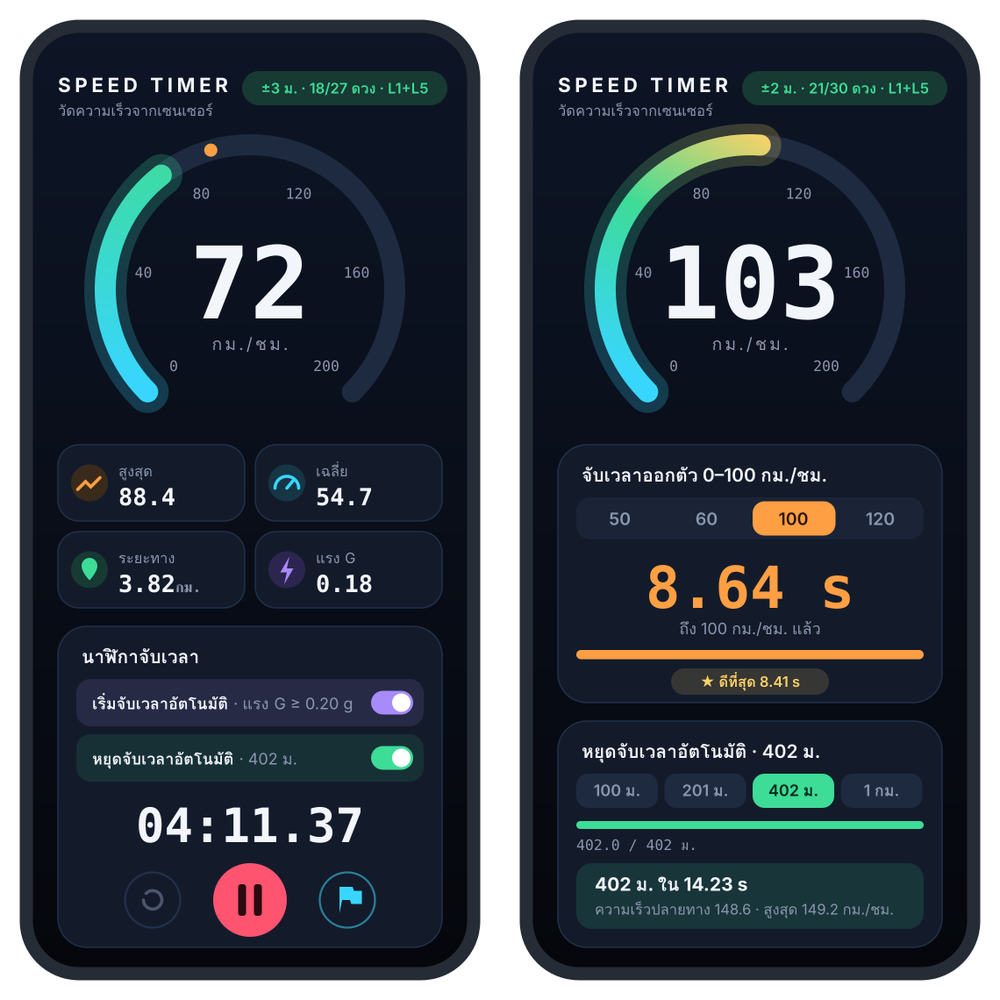

<p align="center">
  
</p>

<h1 align="center">Speed Timer</h1>

<p align="center">
  GPS speedometer, stopwatch and performance timer for Android.<br>
  Built with Kotlin and Jetpack Compose, using the phone's own sensors.
</p>

<p align="center">
  
</p>

## Features

- **Speedometer**: live speed from GPS Doppler data on an animated 0–200 km/h gauge, with a max-speed marker
- **Trip stats**: max speed, average speed, distance and live G-force
- **Stopwatch**: start, pause, laps (best and worst lap highlighted) and reset
- **Auto start**: the stopwatch starts by itself when acceleration reaches a chosen G-force (0.10 / 0.20 / 0.30 / 0.50 g)
- **Auto stop**: the stopwatch stops by itself at a set distance (100 m, 201 m, 402 m, 1 km or any custom value). The finish time is interpolated between GPS fixes.
- **Launch timer**: 0–50 / 60 / 100 / 120 km/h runs that start on the accelerometer launch, with a best time kept for each target
- **GPS quality**: position accuracy, satellites used / visible, and dual-frequency (L1+L5) detection

## Tested on

| Device | Status |
|---|---|
| Samsung Galaxy S21 FE | ✅ Tested |
| Samsung Galaxy S25+ | ✅ Tested |

Minimum Android version: 8.0 (API 26).

## Getting started (macOS)

```bash
# 1. One-time setup: installs Homebrew, JDK 17, Gradle, Android SDK, adb
#    and downloads every library the project needs
./install-dev.sh

# 2. Build / install / run
./build.sh            # build -> SpeedTimer.apk
./build.sh install    # build and install on every connected device
./build.sh run        # clean install, launch, and save crash-<id>.txt / users-<id>.txt
```

Before you install, turn on **Developer options → USB debugging** on the phone. Apps install for the main user (`--user 0`), not into Secure Folder or Dual App.

You can also open the project in Android Studio and press **Run**.

## How it works

| Measurement | Source |
|---|---|
| Speed | GPS Doppler speed (`Location.speed`) |
| Distance | Speed × time, integrated between fixes (more accurate than position-to-position distance over short runs) |
| Launch detection / G-force | `TYPE_LINEAR_ACCELERATION`, or the accelerometer with a gravity filter when that sensor isn't available |
| GPS quality | `GnssStatus`: satellites used in fix and L5/E5a carrier detection |

## Tips for best accuracy

- Grant **Precise location** and set battery usage to **Unrestricted**.
- Mount the phone firmly with a clear view of the sky.
- Wait until the GPS badge is green (about ±5 m or better) before a run.

## Project structure

```
app/src/main/java/com/tracking/speedtimer/
├── MainActivity.kt     permissions and lifecycle
├── SpeedViewModel.kt   GPS, sensors, stopwatch and timer logic
├── SpeedScreen.kt      Compose UI
└── AppIcons.kt         vector icons
install-dev.sh          developer environment setup
build.sh                build / install / run
```

## Safety

Use the timing features only on closed, safe tracks. Don't operate the phone while driving.
